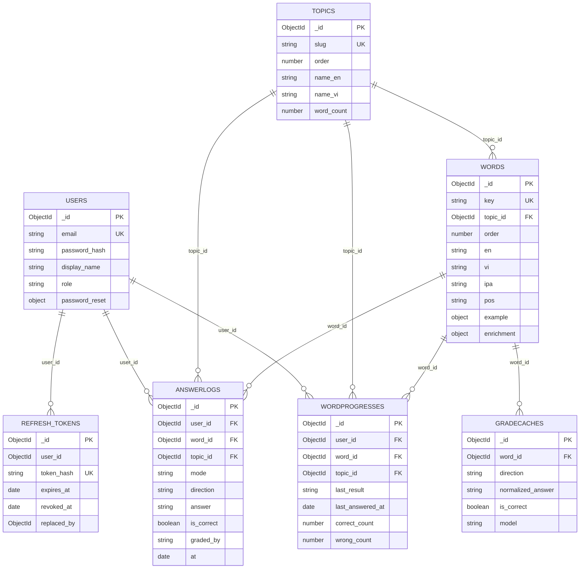

# Tổng quan cấu trúc và quan hệ DB (MongoDB)

> Cập nhật: 2026-11-08. Nguồn: các file `*.schema.ts` trong `src/auth/schemas/` và `src/vocabulary/schemas/`.
> MongoDB không ép khóa ngoại: quan hệ dưới đây là quan hệ logic qua `ObjectId` (`ref`), do code đảm bảo toàn vẹn.
> Quy ước chung: `versionKey: false`; `created_at`/`updated_at` do Mongoose tự thêm (`timestamps`) với mọi collection, trừ khi ghi chú khác.

## 1. Sơ đồ quan hệ (ERD)

Chia theo nhóm:
- **Dữ liệu dùng chung (không thuộc user):** `topics`, `words`, `gradecaches`.
- **Dữ liệu theo user (luôn lọc theo `user_id`):** `users`, `refresh_tokens`, `wordprogresses`, `answerlogs`.

## 2. Chi tiết từng collection

### 2.1 `users` (module `auth`)
| Field | Kiểu | Ghi chú |
|---|---|---|
| `email` | string | bắt buộc, unique, tự lowercase + trim |
| `password_hash` | string | bcrypt, không bao giờ trả ra API |
| `display_name` | string \| null | mặc định `null` |
| `role` | `'user'` \| `'admin'` | mặc định `user` |
| `password_reset` | object \| null | trạng thái quên mật khẩu, mặc định `null` (xem dưới) |

Object con `password_reset` (embedded, không có `_id`):
| Field | Kiểu | Ghi chú |
|---|---|---|
| `otp_hash` | string \| null | HMAC-SHA256 của OTP, khoá `JWT_SECRET`; `null` sau khi OTP được dùng |
| `otp_expires_at` | Date \| null | OTP hết hạn sau 5 phút |
| `attempts` | number | số lần nhập sai OTP, tối đa 5 |
| `reset_token_hash` | string \| null | SHA-256 của reset token (cấp sau khi verify OTP) |
| `reset_token_expires_at` | Date \| null | reset token hết hạn sau 5 phút |

Index: `email` (unique); `password_reset.reset_token_hash` (sparse).

### 2.2 `refresh_tokens` (module `auth`)
| Field | Kiểu | Ghi chú |
|---|---|---|
| `user_id` | ObjectId | tham chiếu `users` (không khai `ref`), có index |
| `token_hash` | string | SHA-256 của refresh token, unique |
| `expires_at` | Date | **TTL index** (`expireAfterSeconds: 0`): Mongo tự xoá khi quá hạn |
| `revoked_at` | Date \| null | khi logout, rotate hoặc đổi mật khẩu |
| `replaced_by` | ObjectId \| null | `_id` của token thay thế khi rotate (phát hiện dùng lại token cũ) |

Đổi mật khẩu thành công sẽ đặt `revoked_at` cho mọi token còn hiệu lực của user.

### 2.3 `topics` (module `vocabulary`)
| Field | Kiểu | Ghi chú |
|---|---|---|
| `slug` | string | unique |
| `order` | number | thứ tự hiển thị |
| `name_en`, `name_vi` | string | tên chủ đề |
| `word_count` | number | số từ trong chủ đề, mặc định 0 |

### 2.4 `words` (module `vocabulary`)
| Field | Kiểu | Ghi chú |
|---|---|---|
| `key` | string | unique, khoá nhận diện từ (dùng khi seed) |
| `topic_id` | ObjectId | ref `Topic` |
| `order` | number | thứ tự trong chủ đề |
| `en`, `vi` | string | nghĩa tiếng Anh / tiếng Việt |
| `ipa`, `pos` | string \| null | phiên âm, loại từ |
| `example` | `{ en, vi }` \| null | embedded, không có `_id` |
| `enrichment` | `{ status, model, at }` | embedded; `status`: `pending` \| `done` \| `failed` \| `edited` (mặc định `pending`) |

Index: `{ topic_id, order }`; `key` (unique).

### 2.5 `wordprogresses` (module `vocabulary`)
Tiến độ **hiện tại** của một user với một từ (một document cho mỗi cặp user + từ).
| Field | Kiểu | Ghi chú |
|---|---|---|
| `user_id` | ObjectId | ref `User` |
| `word_id` | ObjectId | ref `Word` |
| `topic_id` | ObjectId | ref `Topic` (lưu lặp để query theo chủ đề) |
| `last_result` | `'correct'` \| `'wrong'` | kết quả lần trả lời gần nhất |
| `last_answered_at` | Date | |
| `correct_count`, `wrong_count` | number | mặc định 0 |

Index: `{ user_id, word_id }` **unique**; `{ user_id, topic_id, last_result }`.

### 2.6 `answerlogs` (module `vocabulary`)
Nhật ký **từng lần** trả lời (chỉ thêm, dùng cho lịch sử).
| Field | Kiểu | Ghi chú |
|---|---|---|
| `user_id`, `word_id`, `topic_id` | ObjectId | ref `User`, `Word`, `Topic` |
| `mode` | `'flashcard'` \| `'quiz'` \| `'review'` | chế độ học |
| `direction` | `'en_vi'` \| `'vi_en'` | chiều dịch |
| `answer` | string | câu trả lời của user, mặc định rỗng |
| `is_correct` | boolean \| null | `null` khi chưa chấm |
| `graded_by` | `'exact'` \| `'cache'` \| `'ai'` \| `'skipped'` \| `'ungraded'` | cách chấm |
| `at` | Date | thời điểm trả lời |

Index: `{ user_id, at: -1 }`; `{ user_id, word_id, at: -1 }`.

### 2.7 `gradecaches` (module `vocabulary`)
Cache kết quả chấm bằng AI (Groq), dùng chung mọi user.
| Field | Kiểu | Ghi chú |
|---|---|---|
| `word_id` | ObjectId | ref `Word` |
| `direction` | `'en_vi'` \| `'vi_en'` | |
| `normalized_answer` | string | câu trả lời đã chuẩn hoá |
| `is_correct` | boolean | kết quả chấm |
| `model` | string | model AI đã chấm |

Index: `{ word_id, direction, normalized_answer }` **unique**.

## 3. Bảng quan hệ

| Từ (con) | Field | Đến (cha) | Quan hệ | Ghi chú |
|---|---|---|---|---|
| `refresh_tokens` | `user_id` | `users` | N-1 | không khai `ref`; xoá theo TTL |
| `words` | `topic_id` | `topics` | N-1 | |
| `wordprogresses` | `user_id` | `users` | N-1 | cặp `(user_id, word_id)` unique |
| `wordprogresses` | `word_id` | `words` | N-1 | |
| `wordprogresses` | `topic_id` | `topics` | N-1 | dữ liệu lặp từ `words.topic_id` |
| `answerlogs` | `user_id`, `word_id`, `topic_id` | `users`, `words`, `topics` | N-1 mỗi cái | |
| `gradecaches` | `word_id` | `words` | N-1 | bộ ba `(word_id, direction, normalized_answer)` unique |
| `users.password_reset` | embedded | `users` | 1-1 | không phải collection riêng |

## 4. Lưu ý
- **Không có transaction** (DB standalone, không phải replica set): các thao tác nhiều bước dựa vào update nguyên tử trên một document.
- **Xoá không cascade:** xoá một `user`/`word`/`topic` sẽ không tự xoá dữ liệu con. Hiện chưa có API xoá các thực thể này.
- **Tên collection chưa đồng nhất rule:** `refresh_tokens` có dấu gạch dưới, trong khi rule yêu cầu viết liền không dấu (ví dụ `refreshtokens`). Đổi tên cần migration, chưa thực hiện.
- Dữ liệu `password_reset` hết hạn không tự bị xoá (không có TTL vì nằm trong document `users`); chỉ chứa hash và bị ghi đè khi xin OTP mới hoặc xoá khi đổi mật khẩu thành công.
- Collection `users` đã có trước khi thêm `password_reset`: user cũ chưa có field này, được coi như `null`, không cần migration.

