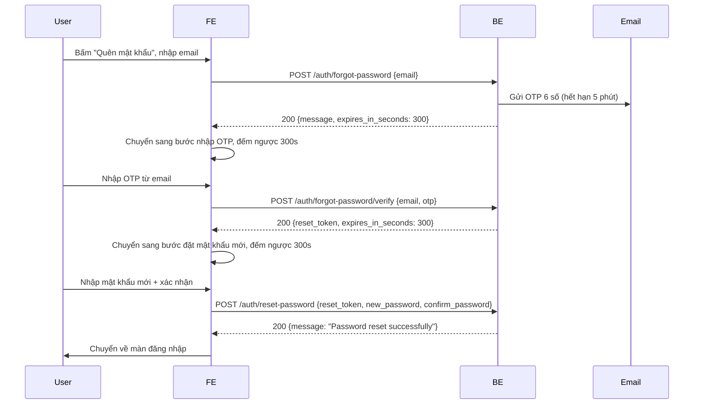

# Handoff FE: Quên mật khẩu (forgot-password)

> Tài liệu cho FE ráp API. Nguồn: `specify.md` của tính năng. Cả 3 API đều **công khai**: không gửi header `Authorization`.
> Format JSON: key `snake_case`. Chưa đánh version API (không có `/api/v1`).

## 1. Tổng quan flow



Có 3 bước màn hình:

| Bước | Màn hình | API |
|---|---|---|
| 1 | Nhập email | `POST /auth/forgot-password` |
| 2 | Nhập OTP (có đồng hồ đếm ngược + nút gửi lại) | `POST /auth/forgot-password/verify` |
| 3 | Nhập mật khẩu mới + xác nhận | `POST /auth/reset-password` |

## 2. API

### 2.1 Gửi OTP: `POST /auth/forgot-password`
Request:
```json
{ "email": "user@example.com" }
```
- `email`: string, tự trim, tối đa 254 ký tự, đúng định dạng email. Không phân biệt hoa thường.

Response `200`:
```json
{ "message": "OTP sent", "expires_in_seconds": 300 }
```
- FE dùng `expires_in_seconds` để đếm ngược (đừng hard-code 300).
- Mỗi lần gọi API này sẽ **tạo OTP mới và vô hiệu OTP cũ**. Nút "Gửi lại mã" chỉ cần gọi lại API này.

Lỗi:
| Status | `message` | Khi nào | FE xử lý |
|---|---|---|---|
| 400 | `email must be a valid email address` | Email sai định dạng | Hiện lỗi dưới ô email |
| 404 | `Email is not registered` | Email chưa đăng ký | Hiện "Email chưa được đăng ký" |
| 503 | `Unable to send OTP email` | Server gửi mail lỗi | Hiện "Không gửi được email, thử lại sau", cho bấm thử lại |

### 2.2 Xác thực OTP: `POST /auth/forgot-password/verify`
Request:
```json
{ "email": "user@example.com", "otp": "012345" }
```
- `email`: giống bước 1 (FE giữ lại email từ bước 1, không bắt user nhập lại).
- `otp`: **string đúng 6 chữ số**. Phải gửi dạng string để giữ số 0 đầu (`"012345"`, không phải number).

Response `200`:
```json
{ "reset_token": "Zm9v...", "expires_in_seconds": 300 }
```
- `reset_token`: chuỗi dùng cho bước 3. Hiệu lực 5 phút kể từ lúc cấp, dùng **1 lần**.
- Sau khi verify thành công, OTP bị tiêu thụ: không verify lại được. Nếu user quay lại bước 2 thì phải xin OTP mới.

Lỗi:
| Status | `message` | Khi nào | FE xử lý |
|---|---|---|---|
| 400 | `email must be a valid email address` | Email sai định dạng | Hiếm khi xảy ra nếu FE đã validate |
| 400 | `otp must be a 6-digit code` | OTP không đúng 6 chữ số | Validate ở FE trước khi gọi |
| 400 | `OTP is invalid or expired` | OTP sai, hết hạn, đã dùng, hoặc đã sai quá 5 lần | Hiện "Mã không đúng hoặc đã hết hạn". Cho user nhập lại hoặc bấm gửi lại |
| 404 | `Email is not registered` | Email không tồn tại | Quay về bước 1 |

Lưu ý quan trọng: **sai OTP tối đa 5 lần**. Sau lần sai thứ 5, OTP bị vô hiệu, kể cả nhập đúng cũng báo `OTP is invalid or expired`. Khi đó user phải bấm "Gửi lại mã". BE trả cùng một message cho mọi trường hợp lỗi OTP nên FE **không** phân biệt được sai hay hết hạn; hãy dùng đồng hồ đếm ngược ở FE để gợi ý user.

### 2.3 Đặt mật khẩu mới: `POST /auth/reset-password`
Request:
```json
{
  "reset_token": "Zm9v...",
  "new_password": "newpassword1",
  "confirm_password": "newpassword1"
}
```
- `reset_token`: token nhận từ bước 2 (hoặc token mới từ lỗi 400 mismatch bên dưới).
- `new_password`: 8 đến 72 **byte** (UTF-8, ký tự có dấu tính nhiều byte). Cùng luật với đăng ký.
- `confirm_password`: string. FE nên so khớp với `new_password` trước khi gọi, nhưng BE vẫn kiểm tra lại.

Response `200`:
```json
{ "message": "Password reset successfully" }
```
- **Không** trả access/refresh token. FE chuyển về màn đăng nhập để user đăng nhập bằng mật khẩu mới.
- BE đã **thu hồi mọi refresh token** của user, nên mọi phiên đăng nhập cũ (kể cả thiết bị khác) sẽ không refresh được nữa. FE nên xoá token đang lưu (nếu có) rồi điều hướng về login.

Lỗi:
| Status | `message` | Khi nào | FE xử lý |
|---|---|---|---|
| 400 | `reset_token must be a non-empty string` | Thiếu token | Lỗi lập trình, quay về bước 1 |
| 400 | `new_password must be between 8 and 72 bytes` | Mật khẩu sai độ dài | Hiện lỗi dưới ô mật khẩu. **Token vẫn dùng được**, cứ nhập lại |
| 400 | `confirm_password must be a string` | Thiếu `confirm_password` | Validate ở FE |
| 400 | `confirm_password must match new_password` | Hai mật khẩu không khớp | **Xem mục đặc biệt dưới** |
| 401 | `Reset token is invalid or expired` | Token sai, hết hạn hoặc đã dùng | Hiện "Phiên đặt lại mật khẩu đã hết hạn", đưa user về bước 1 |

**Trường hợp đặc biệt: 400 `confirm_password must match new_password`.** BE đã vô hiệu token cũ và trả kèm token mới trong body lỗi:
```json
{
  "statusCode": 400,
  "message": "confirm_password must match new_password",
  "error": "Bad Request",
  "reset_token": "bmV3...",
  "expires_in_seconds": 300
}
```
FE **phải thay `reset_token` đang giữ bằng `reset_token` mới này** (và reset đồng hồ đếm ngược theo `expires_in_seconds`), rồi cho user nhập lại. Nếu dùng token cũ sẽ nhận 401. Đây là trường hợp duy nhất mà body lỗi có thêm field ngoài format chuẩn.

## 3. Format lỗi chung
Mọi lỗi theo format mặc định của Nest:
```json
{ "statusCode": 404, "message": "Email is not registered", "error": "Not Found" }
```
- `message` là string (tiếng Anh). FE nên **map theo `statusCode` + `message`** sang text hiển thị (tiếng Việt), không hiển thị thẳng message của BE.
- Lỗi `400` do body sai kiểu (ví dụ không phải JSON object) có `message: "Request body must be a JSON object"`.

## 4. Gợi ý quản lý state ở FE
- Giữ `email`, `reset_token` trong state của flow (bộ nhớ). **Không** lưu `reset_token` vào localStorage/sessionStorage, không log ra console.
- Đồng hồ đếm ngược dựa trên `expires_in_seconds` từ response (tính mốc hết hạn bằng thời gian máy lúc nhận response). Hết giờ:
  - Bước 2: vô hiệu nút "Xác nhận", chỉ cho bấm "Gửi lại mã".
  - Bước 3: báo hết phiên, đưa về bước 1.
- Nút "Gửi lại mã": gọi lại `POST /auth/forgot-password`, reset đồng hồ, xoá ô OTP. Nên có cooldown ngắn ở FE (ví dụ 30 đến 60 giây) vì BE **chưa có rate limit**.
- Chặn bấm nhiều lần (disable nút khi đang gọi API).
- Ô OTP: chỉ cho nhập số, tối đa 6 ký tự, giữ kiểu string.

## 5. Bảng tổng hợp trạng thái và điều hướng
| Tình huống | Hành động FE |
|---|---|
| Bước 1 thành công | Sang bước 2, bắt đầu đếm ngược |
| Bước 1: 404 | Ở lại bước 1, báo email chưa đăng ký |
| Bước 1: 503 | Ở lại bước 1, cho thử lại |
| Bước 2 thành công | Lưu `reset_token`, sang bước 3, đếm ngược lại |
| Bước 2: 400 OTP invalid | Ở lại bước 2, cho nhập lại hoặc gửi lại |
| Bước 3 thành công | Xoá state, xoá token đăng nhập cũ, về màn login (có thể kèm thông báo "Đổi mật khẩu thành công") |
| Bước 3: 400 mismatch | Thay `reset_token` bằng token mới trong body, ở lại bước 3 |
| Bước 3: 400 độ dài mật khẩu | Ở lại bước 3, giữ nguyên token |
| Bước 3: 401 | Về bước 1 |

## 6. Test nhanh bằng curl
```bash
# 1. Gửi OTP
curl -X POST http://localhost:3000/auth/forgot-password \
  -H 'Content-Type: application/json' \
  -d '{"email":"user@example.com"}'

# 2. Verify OTP (lấy từ email)
curl -X POST http://localhost:3000/auth/forgot-password/verify \
  -H 'Content-Type: application/json' \
  -d '{"email":"user@example.com","otp":"123456"}'

# 3. Đặt mật khẩu mới
curl -X POST http://localhost:3000/auth/reset-password \
  -H 'Content-Type: application/json' \
  -d '{"reset_token":"<reset_token>","new_password":"newpassword1","confirm_password":"newpassword1"}'
```
Port `3000` là mặc định (`PORT` trong `.env`). Swagger của BE có mô tả 3 route này dưới tag `auth`.

## 7. Lưu ý khác
- OTP được gửi tới đúng email user nhập (phải là email đã đăng ký). Email có thể vào mục Spam, nên nhắc user kiểm tra.
- Trong môi trường dev mà BE chưa cấu hình SMTP, BE **không gửi mail** nhưng vẫn trả 200. Cần có SMTP trong `.env` để nhận OTP thật.
- BE trả 404 khi email không tồn tại, nên FE có thể bị dò email. Đây là quyết định đã chấp nhận của BE, FE không cần xử lý thêm.
- Mỗi user chỉ có một phiên quên mật khẩu hoạt động: gửi OTP mới sẽ huỷ OTP và reset token cũ.

